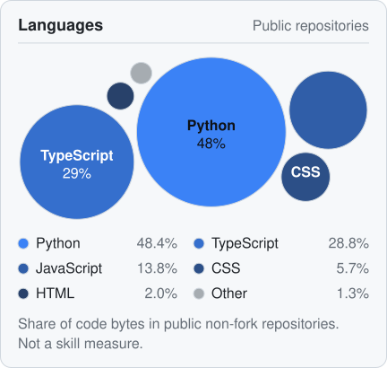
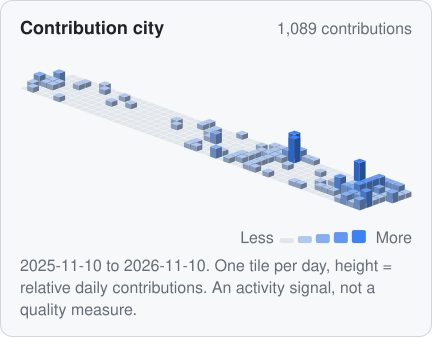
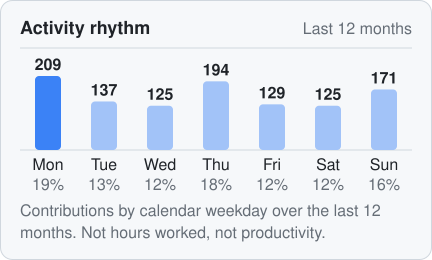
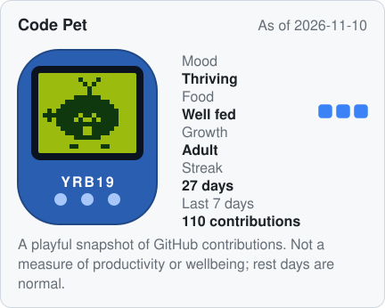

# Rishit Babbar
### CS + AI Student · Systems Builder

I build AI-powered systems, developer tools, automation pipelines, and full-stack products.

My projects usually start with a practical problem and grow into systems around it — combining software, data, APIs, automation, and AI.

`AI Systems` · `Developer Tools` · `Automation` · `Fintech` · `Systems`

<!-- PROFILEOS:START:SIGNAL -->
<picture>
  <source media="(prefers-color-scheme: dark)" srcset="assets/generated/profile-signal.dark.svg">
  <source media="(prefers-color-scheme: light)" srcset="assets/generated/profile-signal.light.svg">
  
</picture>
<!-- PROFILEOS:END:SIGNAL -->

<!-- PROFILEOS:START:BUILDING -->
**Exploring** · Agentic systems · AI infrastructure  
**Learning** · Systems design · Distributed workflows

**Recent activity** · [NetOS](https://github.com/YRB19/NetOS) · [UsageOS](https://github.com/YRB19/UsageOS) · [FREYA](https://github.com/YRB19/FREYA) public commits, last 30 days (from GitHub, not a statement of intent)  
**New on GitHub** · [PersonaOS](https://github.com/YRB19/PersonaOS) first seen 2026-10-27

**Recently shipped**  
`11/07` **NetOS** — [fix(slice-11): formatting — model\_version, schema](https://github.com/YRB19/NetOS/commit/a80a41a681a2fa37d71cbca589c6e049a63e4db1)  
`11/07` **NetOS** — [fix(slice-11): update console, boundary, helpers tests — requested/re…](https://github.com/YRB19/NetOS/commit/b32a50003e9134d7f27d4f95d4bbe7469a985cbd)  
`11/05` **FREYA** — [feat: Phase 9A reconciliation framework + executor section verification](https://github.com/YRB19/FREYA/commit/3346eabf682d6db4e6813675e2c0a9f6b23627b9)  
`10/29` **UsageOS** — [fix(extension): small fixes for options, popup, container strategy, a…](https://github.com/YRB19/UsageOS/commit/a9c30742d62c5789c7218ea5b20fc995c17530dc)  
`10/29` **UsageOS** — [refactor(extension): update chrome and firefox manifests, remove elec…](https://github.com/YRB19/UsageOS/commit/b14dae20be22e169e778810960e551c09513a298)  
`10/27` **PersonaOS** — [Add bugs.md and bugs.txt to .gitignore](https://github.com/YRB19/PersonaOS/commit/0533d17e4d4666f9241c423cffe12a3ec3d3f20c)
<!-- PROFILEOS:END:BUILDING -->

<<<<<<< HEAD

---

## Featured Systems
<!-- PROFILEOS:START:SELECTED_SYSTEMS -->
<a href="https://github.com/YRB19/UsageOS">
<picture>
  <source media="(prefers-color-scheme: dark)" srcset="assets/generated/card-usageos.dark.svg">
  <source media="(prefers-color-scheme: light)" srcset="assets/generated/card-usageos.light.svg">
  
</picture>
</a>

[Docs](https://github.com/YRB19/UsageOS/blob/main/DEPLOY.md)

<a href="https://github.com/YRB19/ResearchOS">
<picture>
  <source media="(prefers-color-scheme: dark)" srcset="assets/generated/card-researchos.dark.svg">
  <source media="(prefers-color-scheme: light)" srcset="assets/generated/card-researchos.light.svg">
  
</picture>
</a>

[Docs](https://github.com/YRB19/ResearchOS/blob/main/reference/ARCHITECTURE.md)

<a href="https://github.com/YRB19/ClipOS">
<picture>
  <source media="(prefers-color-scheme: dark)" srcset="assets/generated/card-clipos.dark.svg">
  <source media="(prefers-color-scheme: light)" srcset="assets/generated/card-clipos.light.svg">
  
</picture>
</a>

<a href="https://github.com/YRB19/CompanionOS">
<picture>
  <source media="(prefers-color-scheme: dark)" srcset="assets/generated/card-companionos.dark.svg">
  <source media="(prefers-color-scheme: light)" srcset="assets/generated/card-companionos.light.svg">
  
</picture>
</a>

<a href="https://github.com/YRB19/NetOS">
<picture>
  <source media="(prefers-color-scheme: dark)" srcset="assets/generated/card-netos.dark.svg">
  <source media="(prefers-color-scheme: light)" srcset="assets/generated/card-netos.light.svg">
  
</picture>
</a>

<a href="https://github.com/YRB19/FREYA">
<picture>
  <source media="(prefers-color-scheme: dark)" srcset="assets/generated/card-freya.dark.svg">
  <source media="(prefers-color-scheme: light)" srcset="assets/generated/card-freya.light.svg">
  
</picture>
</a>
<!-- PROFILEOS:END:SELECTED_SYSTEMS -->

=======
>>>>>>> 8c15ed8 (docs: rewrite README table layout + add layout/motion to FEATURES.md)
<!-- PROFILEOS:START:RELEASES -->
<!-- PROFILEOS:END:RELEASES -->

<!-- PROFILEOS:START:SELECTED_SYSTEMS -->
<!-- PROFILEOS:END:SELECTED_SYSTEMS -->

<!-- PROFILEOS:START:PROJECT_MAP -->
<picture>
  <source media="(prefers-color-scheme: dark)" srcset="assets/generated/project-map.dark.svg">
  <source media="(prefers-color-scheme: light)" srcset="assets/generated/project-map.light.svg">
  
</picture>

[UsageOS](https://github.com/YRB19/UsageOS) · [ResearchOS](https://github.com/YRB19/ResearchOS) · [ClipOS](https://github.com/YRB19/ClipOS) · [CompanionOS](https://github.com/YRB19/CompanionOS) · [NetOS](https://github.com/YRB19/NetOS) · [FREYA](https://github.com/YRB19/FREYA) · [Cosmic Explorer](https://github.com/YRB19/Cosmic-Explorer) · [Finwise](https://github.com/YRB19/Finwise) · [N8N-YT](https://github.com/YRB19/N8N-YT) · [RepoHealth](https://github.com/YRB19/repohealth)
<!-- PROFILEOS:END:PROJECT_MAP -->

<table>
<tr>
<td valign="top" width="50%">

### What I Build

- **AI systems** — research, media, and agent-style pipelines
- **Developer tools** — software that makes engineering workflows observable and faster
- **Automation** — pipelines that remove repetitive work
- **Fintech & data** — dashboards and analysis tools
- **Full-stack products** — from UI to API to storage

</td>
<td valign="top" width="50%">

### Stack

<!-- PROFILEOS:START:STACK -->
**Languages** · Python · TypeScript · JavaScript · Rust · SQL  
**Frontend** · React · Next.js · Vite · Tailwind CSS  
**Backend \& Data** · FastAPI · PostgreSQL · SQLite · SQLModel · Redis  
**AI \& Media** · LLMs · AI Agents · Whisper · NVIDIA NIM · OpenCV · ffmpeg  
**Systems \& Infrastructure** · Docker · Tauri · Git · GitHub Actions · Vercel  
**Automation \& Integrations** · n8n · Telegram Bot API · Google Gemini API  
**Testing** · pytest · Vitest · Playwright
<!-- PROFILEOS:END:STACK -->

<<<<<<< HEAD
### Languages
<!-- PROFILEOS:START:LANGUAGE_BUBBLES -->
<picture>
  <source media="(prefers-color-scheme: dark)" srcset="assets/generated/language-bubbles.dark.svg">
  <source media="(prefers-color-scheme: light)" srcset="assets/generated/language-bubbles.light.svg">
  
</picture>
<!-- PROFILEOS:END:LANGUAGE_BUBBLES -->
=======
</td>
</tr>
</table>
>>>>>>> 8c15ed8 (docs: rewrite README table layout + add layout/motion to FEATURES.md)

<!-- PROFILEOS:START:CITY -->
<picture>
  <source media="(prefers-color-scheme: dark)" srcset="assets/generated/contribution-city.dark.svg">
  <source media="(prefers-color-scheme: light)" srcset="assets/generated/contribution-city.light.svg">
  
</picture>
<!-- PROFILEOS:END:CITY -->

<<<<<<< HEAD
### Activity Rhythm
<!-- PROFILEOS:START:RHYTHM -->
<picture>
  <source media="(prefers-color-scheme: dark)" srcset="assets/generated/activity-rhythm.dark.svg">
  <source media="(prefers-color-scheme: light)" srcset="assets/generated/activity-rhythm.light.svg">
  
</picture>
<!-- PROFILEOS:END:RHYTHM -->

### Code Pet
<!-- PROFILEOS:START:PET -->
<picture>
  <source media="(prefers-color-scheme: dark)" srcset="assets/generated/code-pet.dark.svg">
  <source media="(prefers-color-scheme: light)" srcset="assets/generated/code-pet.light.svg">
  
</picture>
<!-- PROFILEOS:END:PET -->

<!-- PROFILEOS:START:ACTIVITY -->
<picture>
  <source media="(prefers-color-scheme: dark)" srcset="assets/generated/monthly.dark.svg">
  <source media="(prefers-color-scheme: light)" srcset="assets/generated/monthly.light.svg">
  
</picture>

<picture>
  <source media="(prefers-color-scheme: dark)" srcset="assets/generated/activity.dark.svg">
  <source media="(prefers-color-scheme: light)" srcset="assets/generated/activity.light.svg">
  
</picture>
<!-- PROFILEOS:END:ACTIVITY -->

---

=======
>>>>>>> 8c15ed8 (docs: rewrite README table layout + add layout/motion to FEATURES.md)
## Engineering Approach

I use AI throughout the engineering loop — research, architecture, implementation, testing, debugging, and iteration.  
The goal isn't to generate more code.  
The goal is to build useful systems that are understandable, testable, and maintainable.

### Earlier Builds

<!-- PROFILEOS:START:EARLIER_BUILDS -->
[RepoHealth](https://github.com/YRB19/repohealth) · [Finwise](https://github.com/YRB19/Finwise) · [Cosmic Explorer](https://github.com/YRB19/Cosmic-Explorer) · [N8N-YT](https://github.com/YRB19/N8N-YT)

Also: Smart House (Arduino + RFID) · Rainwater Harvester · LEGO Mindstorms · Trex Game · Bank Statement Analyzer · Mock IPL Auction platform · ShikshaSahayak · PersonaOS · IDEMI Data Science \& Business Analytics
<!-- PROFILEOS:END:EARLIER_BUILDS -->

<!-- PROFILEOS:START:TIMELINE -->
### Project timeline

`2026-10-22` **NetOS** — First seen by ProfileOS  
`2026-10-22` **FREYA** — First seen by ProfileOS  
`2026-09-10` **FREYA** — [Repository created](https://github.com/YRB19/FREYA)  
`2026-09-05` **NetOS** — [Repository created](https://github.com/YRB19/NetOS)  
`2026-07-18` **CompanionOS** — [Repository created](https://github.com/YRB19/CompanionOS)  
`2026-07-11` **ClipOS** — [Repository created](https://github.com/YRB19/ClipOS)  
`2026-07-08` **UsageOS** — [Repository created](https://github.com/YRB19/UsageOS)  
`2026-06-26` **ResearchOS** — [Repository created](https://github.com/YRB19/ResearchOS)  

Dates come from GitHub (repository creation, release publication) or sourced milestones. "First seen" is when ProfileOS first listed a project, not when it was started.
<!-- PROFILEOS:END:TIMELINE -->

<!-- PROFILEOS:START:CTA -->
<picture>
  <source media="(prefers-color-scheme: dark)" srcset="assets/generated/collaboration.dark.svg">
  <source media="(prefers-color-scheme: light)" srcset="assets/generated/collaboration.light.svg">
  
</picture>

[GitHub](https://github.com/YRB19)
<!-- PROFILEOS:END:CTA -->

<!-- PROFILEOS:START:FOOTER -->
<!-- PROFILEOS:END:FOOTER -->
