

# Rishit Babbar
### CS + AI Student · Systems Builder

I build AI-powered systems, developer tools, automation pipelines, and full-stack products.

My projects usually start with a practical problem and grow into systems around it — combining software, data, APIs, automation, and AI.

`AI Systems` · `Developer Tools` · `Automation` · `Fintech` · `Systems`

## Currently Building
<!-- PROFILEOS:START:CURRENTLY_BUILDING -->
● [NetOS](https://github.com/YRB19/NetOS) — active  
○ [UsageOS](https://github.com/YRB19/UsageOS) — quieter  
○ [FREYA](https://github.com/YRB19/FREYA) — quieter
<!-- PROFILEOS:END:CURRENTLY_BUILDING -->

<!-- PROFILEOS:START:NOW -->
**NOW**  
Building: [NetOS](https://github.com/YRB19/NetOS)  
Exploring: Agentic systems · AI infrastructure  
Learning: Systems design · Distributed workflows  
Newest build: [FREYA](https://github.com/YRB19/FREYA) · created 2026-09-10  
Most commits (last 30 days): [NetOS](https://github.com/YRB19/NetOS)
<!-- PROFILEOS:END:NOW -->

## Development Pulse
<!-- PROFILEOS:START:PULSE -->
<picture>
  <source media="(prefers-color-scheme: dark)" srcset="assets/generated/pulse.dark.svg">
  <source media="(prefers-color-scheme: light)" srcset="assets/generated/pulse.light.svg">
  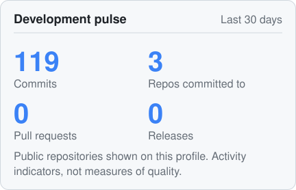
</picture>
<!-- PROFILEOS:END:PULSE -->

## Recently Shipped
<!-- PROFILEOS:START:RECENTLY_SHIPPED -->
`10/25` **NetOS** — [test(slice-8): update existing pipeline tests to use JournaledHarness…](https://github.com/YRB19/NetOS/commit/86e519a76fadca57b80e90c5ec7a113c1f295faf)  
`10/25` **NetOS** — [test(slice-8): add unit \& integration tests for decision journal — co…](https://github.com/YRB19/NetOS/commit/fd550788850252c592ba573081fc703c9887cf7f)  
`10/17` **FREYA** — [feat: Phase 9A - Reconciliation health and transaction models](https://github.com/YRB19/FREYA/commit/b09ba8642a0d270c3abb5992a3a71a0958c91eb3)  
`10/08` **UsageOS** — [feat(frontend): add save error handling for maintenance notes](https://github.com/YRB19/UsageOS/commit/a8f6a68ebbe58b1be53fa5722d73d4ca40020a64)  
`10/08` **UsageOS** — [feat(frontend): add API key authentication via axios interceptor](https://github.com/YRB19/UsageOS/commit/4dca1f30438046c75d5effd3b0c0cc41d7fe72e0)  
`09/25` **FREYA** — [fix: test\_layer\_8 \& executor](https://github.com/YRB19/FREYA/commit/00220bf4388b19037e2468304bd7dbbe1ff40df9)
<!-- PROFILEOS:END:RECENTLY_SHIPPED -->

<!-- PROFILEOS:START:RELEASES -->
<!-- PROFILEOS:END:RELEASES -->

## The OS Series
<!-- PROFILEOS:START:OS_SERIES -->
*Building focused systems around messy real-world problems.*

<picture>
  <source media="(prefers-color-scheme: dark)" srcset="assets/generated/os-series.dark.svg">
  <source media="(prefers-color-scheme: light)" srcset="assets/generated/os-series.light.svg">
  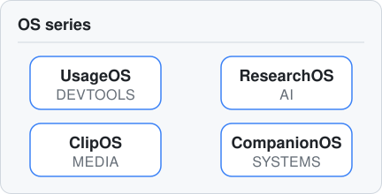
</picture>

[UsageOS](https://github.com/YRB19/UsageOS) · [ResearchOS](https://github.com/YRB19/ResearchOS) · [ClipOS](https://github.com/YRB19/ClipOS) · [CompanionOS](https://github.com/YRB19/CompanionOS) · [NetOS](https://github.com/YRB19/NetOS) · [FREYA](https://github.com/YRB19/FREYA)
<!-- PROFILEOS:END:OS_SERIES -->

## Selected Systems
<!-- PROFILEOS:START:SELECTED_SYSTEMS -->
<a href="https://github.com/YRB19/UsageOS">
<picture>
  <source media="(prefers-color-scheme: dark)" srcset="assets/generated/card-usageos.dark.svg">
  <source media="(prefers-color-scheme: light)" srcset="assets/generated/card-usageos.light.svg">
  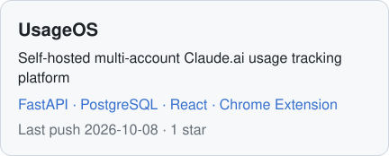
</picture>
</a>

[Docs](https://github.com/YRB19/UsageOS/blob/main/DEPLOY.md)

<a href="https://github.com/YRB19/ResearchOS">
<picture>
  <source media="(prefers-color-scheme: dark)" srcset="assets/generated/card-researchos.dark.svg">
  <source media="(prefers-color-scheme: light)" srcset="assets/generated/card-researchos.light.svg">
  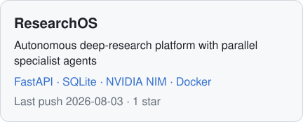
</picture>
</a>

[Docs](https://github.com/YRB19/ResearchOS/blob/main/reference/ARCHITECTURE.md)

<a href="https://github.com/YRB19/ClipOS">
<picture>
  <source media="(prefers-color-scheme: dark)" srcset="assets/generated/card-clipos.dark.svg">
  <source media="(prefers-color-scheme: light)" srcset="assets/generated/card-clipos.light.svg">
  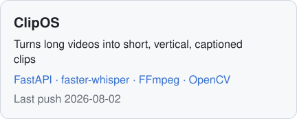
</picture>
</a>

<a href="https://github.com/YRB19/CompanionOS">
<picture>
  <source media="(prefers-color-scheme: dark)" srcset="assets/generated/card-companionos.dark.svg">
  <source media="(prefers-color-scheme: light)" srcset="assets/generated/card-companionos.light.svg">
  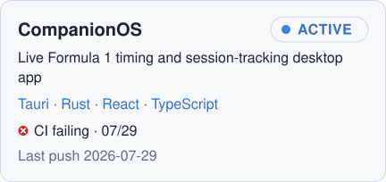
</picture>
</a>

<a href="https://github.com/YRB19/NetOS">
<picture>
  <source media="(prefers-color-scheme: dark)" srcset="assets/generated/card-netos.dark.svg">
  <source media="(prefers-color-scheme: light)" srcset="assets/generated/card-netos.light.svg">
  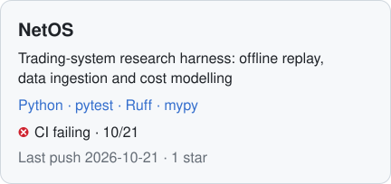
</picture>
</a>

<a href="https://github.com/YRB19/FREYA">
<picture>
  <source media="(prefers-color-scheme: dark)" srcset="assets/generated/card-freya.dark.svg">
  <source media="(prefers-color-scheme: light)" srcset="assets/generated/card-freya.light.svg">
  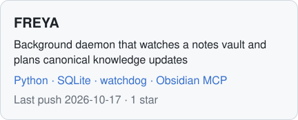
</picture>
</a>
<!-- PROFILEOS:END:SELECTED_SYSTEMS -->

## What I Build

- **AI systems** — research, media, and agent-style pipelines
- **Developer tools** — software that makes engineering workflows observable and faster
- **Automation** — pipelines that remove repetitive work
- **Fintech & data** — dashboards and analysis tools
- **Full-stack products** — from UI to API to storage

## Stack
<!-- PROFILEOS:START:STACK -->
**Languages** · Python · TypeScript · JavaScript · Rust · SQL  
**Frontend** · React · Next.js · Vite · Tailwind CSS  
**Backend \& Data** · FastAPI · PostgreSQL · SQLite · SQLModel · Redis  
**AI \& Media** · LLMs · AI Agents · Whisper · NVIDIA NIM · OpenCV · ffmpeg  
**Systems \& Infrastructure** · Docker · Tauri · Git · GitHub Actions · Vercel  
**Automation \& Integrations** · n8n · Telegram Bot API · Google Gemini API  
**Testing** · pytest · Vitest · Playwright
<!-- PROFILEOS:END:STACK -->

## Engineering Approach

I use AI throughout the engineering loop — research, architecture, implementation, testing, debugging, and iteration.

The goal isn't to generate more code.

The goal is to build useful systems that are understandable, testable, and maintainable.

## Earlier Builds
<!-- PROFILEOS:START:EARLIER_BUILDS -->
[RepoHealth](https://github.com/YRB19/repohealth) · [Finwise](https://github.com/YRB19/Finwise) · [Cosmic Explorer](https://github.com/YRB19/Cosmic-Explorer) · [N8N-YT](https://github.com/YRB19/N8N-YT)

Also: Smart House (Arduino + RFID) · Rainwater Harvester · LEGO Mindstorms · Trex Game · Bank Statement Analyzer · Mock IPL Auction platform · ShikshaSahayak · PersonaOS · IDEMI Data Science \& Business Analytics
<!-- PROFILEOS:END:EARLIER_BUILDS -->

## Activity
<!-- PROFILEOS:START:ACTIVITY -->
<picture>
  <source media="(prefers-color-scheme: dark)" srcset="assets/generated/heatmap.dark.svg">
  <source media="(prefers-color-scheme: light)" srcset="assets/generated/heatmap.light.svg">
  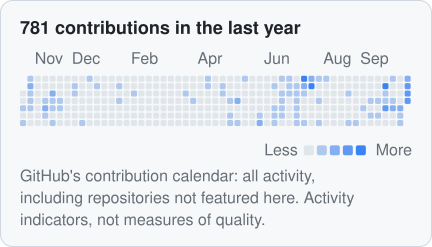
</picture>

<picture>
  <source media="(prefers-color-scheme: dark)" srcset="assets/generated/activity.dark.svg">
  <source media="(prefers-color-scheme: light)" srcset="assets/generated/activity.light.svg">
  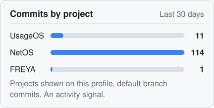
</picture>

<picture>
  <source media="(prefers-color-scheme: dark)" srcset="assets/generated/languages.dark.svg">
  <source media="(prefers-color-scheme: light)" srcset="assets/generated/languages.light.svg">
  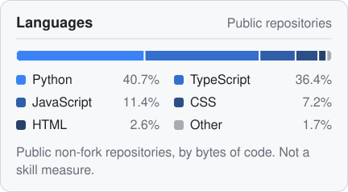
</picture>
<!-- PROFILEOS:END:ACTIVITY -->

<!-- PROFILEOS:START:TIMELINE -->
### Project timeline

`2026-10-22` **NetOS** — First seen by ProfileOS  
`2026-10-22` **FREYA** — First seen by ProfileOS  
`2026-09-10` **FREYA** — [Repository created](https://github.com/YRB19/FREYA)  
`2026-09-05` **NetOS** — [Repository created](https://github.com/YRB19/NetOS)  
`2026-07-18` **CompanionOS** — [Repository created](https://github.com/YRB19/CompanionOS)  
`2026-07-11` **ClipOS** — [Repository created](https://github.com/YRB19/ClipOS)  
`2026-07-08` **UsageOS** — [Repository created](https://github.com/YRB19/UsageOS)  
`2026-06-26` **ResearchOS** — [Repository created](https://github.com/YRB19/ResearchOS)  

Dates come from GitHub (repository creation, release publication) or sourced milestones. "First seen" is when ProfileOS first listed a project, not when it was started.
<!-- PROFILEOS:END:TIMELINE -->

## Links
<!-- PROFILEOS:START:LINKS -->
[GitHub](https://github.com/YRB19)
<!-- PROFILEOS:END:LINKS -->

<!-- PROFILEOS:START:FOOTER -->
Generated by ProfileOS · data snapshot 2026-10-26 · Automate facts. Curate identity.
<!-- PROFILEOS:END:FOOTER -->
