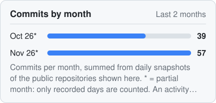
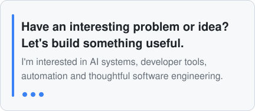

# Rishit Babbar
### CS + AI Student · Systems Builder

I build AI-powered systems, developer tools, automation pipelines, and full-stack products.

My projects usually start with a practical problem and grow into systems around it — combining software, data, APIs, automation, and AI.

`AI Systems` · `Developer Tools` · `Automation` · `Fintech` · `Systems`

---

## Profile Signal
<!-- PROFILEOS:START:SIGNAL -->

<picture>
  <source media="(prefers-color-scheme: dark) and (min-width: 700px)" srcset="assets/generated/overview.dark.svg">
  <source media="(prefers-color-scheme: light) and (min-width: 700px)" srcset="assets/generated/overview.light.svg">
  <source media="(prefers-color-scheme: dark)" srcset="assets/generated/overview-narrow.dark.svg">
  <source media="(prefers-color-scheme: light)" srcset="assets/generated/overview-narrow.light.svg">
  
</picture>

<!-- PROFILEOS:END:SIGNAL -->

---
<!-- PROFILEOS:START:BUILDING -->
## Building in Public

**Exploring** · Agentic systems · AI infrastructure  
**Learning** · Systems design · Distributed workflows

**Recent activity** · [NetOS](https://github.com/YRB19/NetOS) · [UsageOS](https://github.com/YRB19/UsageOS) public commits, last 30 days (from GitHub, not a statement of intent)

**Recently shipped**  
`11/13` **UsageOS** — [fic(frontend) : dead space managment](https://github.com/YRB19/UsageOS/commit/20507cde9f01a2f90a0e857c738db013c6ca6305)  
`11/13` **UsageOS** — [fix(frontend): fix extension options, popup, container strategy, and …](https://github.com/YRB19/UsageOS/commit/ae997a53b01c3553b8fb091d456cdd99dc009b2a)  
`11/13` **NetOS** — [tools(slice-13): multi-market synthetic demo](https://github.com/YRB19/NetOS/commit/e0027bdfb29197593cfd6014dbaa795432fa26ec)  
`11/13` **NetOS** — [test(slice-13): Slice 13 unit + integration tests](https://github.com/YRB19/NetOS/commit/f1407dc5e67328968d3214b32c61c5d34012b0ae)  
`11/05` **FREYA** — [feat: Phase 9A reconciliation framework + executor section verification](https://github.com/YRB19/FREYA/commit/3346eabf682d6db4e6813675e2c0a9f6b23627b9)  
`10/27` **PersonaOS** — [Add bugs.md and bugs.txt to .gitignore](https://github.com/YRB19/PersonaOS/commit/0533d17e4d4666f9241c423cffe12a3ec3d3f20c)
<!-- PROFILEOS:END:BUILDING -->

---
<!-- PROFILEOS:START:SELECTED_SYSTEMS -->
## Featured Systems

<picture>
  <source media="(prefers-color-scheme: dark) and (min-width: 700px)" srcset="assets/generated/featured.dark.svg">
  <source media="(prefers-color-scheme: light) and (min-width: 700px)" srcset="assets/generated/featured.light.svg">
  <source media="(prefers-color-scheme: dark)" srcset="assets/generated/featured-narrow.dark.svg">
  <source media="(prefers-color-scheme: light)" srcset="assets/generated/featured-narrow.light.svg">
  
</picture>

**[UsageOS](https://github.com/YRB19/UsageOS)** · [Docs](https://github.com/YRB19/UsageOS/blob/main/DEPLOY.md)&nbsp;&nbsp;|&nbsp;&nbsp;**[ResearchOS](https://github.com/YRB19/ResearchOS)** · [Docs](https://github.com/YRB19/ResearchOS/blob/main/reference/ARCHITECTURE.md)&nbsp;&nbsp;|&nbsp;&nbsp;**[ClipOS](https://github.com/YRB19/ClipOS)**&nbsp;&nbsp;|&nbsp;&nbsp;**[CompanionOS](https://github.com/YRB19/CompanionOS)**&nbsp;&nbsp;|&nbsp;&nbsp;**[NetOS](https://github.com/YRB19/NetOS)**&nbsp;&nbsp;|&nbsp;&nbsp;**[FREYA](https://github.com/YRB19/FREYA)**

<!-- PROFILEOS:END:SELECTED_SYSTEMS -->

<!-- PROFILEOS:START:RELEASES -->
<!-- PROFILEOS:END:RELEASES -->

---
<!-- PROFILEOS:START:PROJECT_MAP -->
## Systems & Activity

<picture>
  <source media="(prefers-color-scheme: dark) and (min-width: 700px)" srcset="assets/generated/systems.dark.svg">
  <source media="(prefers-color-scheme: light) and (min-width: 700px)" srcset="assets/generated/systems.light.svg">
  <source media="(prefers-color-scheme: dark)" srcset="assets/generated/systems-narrow.dark.svg">
  <source media="(prefers-color-scheme: light)" srcset="assets/generated/systems-narrow.light.svg">
  
</picture>

[UsageOS](https://github.com/YRB19/UsageOS) · [ResearchOS](https://github.com/YRB19/ResearchOS) · [ClipOS](https://github.com/YRB19/ClipOS) · [CompanionOS](https://github.com/YRB19/CompanionOS) · [NetOS](https://github.com/YRB19/NetOS) · [FREYA](https://github.com/YRB19/FREYA) · [Cosmic Explorer](https://github.com/YRB19/Cosmic-Explorer) · [Finwise](https://github.com/YRB19/Finwise) · [N8N-YT](https://github.com/YRB19/N8N-YT) · [RepoHealth](https://github.com/YRB19/repohealth)

<!-- PROFILEOS:END:PROJECT_MAP -->

---

## What I Build

- **AI systems** — research, media, and agent-style pipelines
- **Developer tools** — software that makes engineering workflows observable and faster
- **Automation** — pipelines that remove repetitive work
- **Fintech & data** — dashboards and analysis tools
- **Full-stack products** — from UI to API to storage

---

## Stack
<!-- PROFILEOS:START:STACK -->
**Languages** · Python · TypeScript · JavaScript · Rust · SQL  
**Frontend** · React · Next.js · Vite · Tailwind CSS  
**Backend \& Data** · FastAPI · PostgreSQL · SQLite · SQLModel · Redis  
**AI \& Media** · LLMs · AI Agents · Whisper · NVIDIA NIM · OpenCV · ffmpeg  
**Systems \& Infrastructure** · Docker · Tauri · Git · GitHub Actions · Vercel  
**Automation \& Integrations** · n8n · Telegram Bot API · Google Gemini API  
**Testing** · pytest · Vitest · Playwright
<!-- PROFILEOS:END:STACK -->

---

<!-- PROFILEOS:START:CITY -->
## Commit History

<picture>
  <source media="(prefers-color-scheme: dark)" srcset="assets/generated/monthly.dark.svg">
  <source media="(prefers-color-scheme: light)" srcset="assets/generated/monthly.light.svg">
  
</picture>

<!-- PROFILEOS:END:CITY -->

---

## Engineering Approach

I use AI throughout the engineering loop — research, architecture, implementation, testing, debugging, and iteration.  
The goal isn't to generate more code.  
The goal is to build useful systems that are understandable, testable, and maintainable.

---

## Earlier Builds
<!-- PROFILEOS:START:EARLIER_BUILDS -->
[RepoHealth](https://github.com/YRB19/repohealth) · [Finwise](https://github.com/YRB19/Finwise) · [Cosmic Explorer](https://github.com/YRB19/Cosmic-Explorer) · [N8N-YT](https://github.com/YRB19/N8N-YT)

Also: Smart House (Arduino + RFID) · Rainwater Harvester · LEGO Mindstorms · Trex Game · Bank Statement Analyzer · Mock IPL Auction platform · ShikshaSahayak · PersonaOS · IDEMI Data Science \& Business Analytics
<!-- PROFILEOS:END:EARLIER_BUILDS -->

<!-- PROFILEOS:START:TIMELINE -->
### Project timeline

`2026-10-22` **NetOS** — First seen by ProfileOS  
`2026-10-22` **FREYA** — First seen by ProfileOS  
`2026-09-10` **FREYA** — [Repository created](https://github.com/YRB19/FREYA)  
`2026-09-05` **NetOS** — [Repository created](https://github.com/YRB19/NetOS)  
`2026-07-18` **CompanionOS** — [Repository created](https://github.com/YRB19/CompanionOS)  
`2026-07-11` **ClipOS** — [Repository created](https://github.com/YRB19/ClipOS)  
`2026-07-08` **UsageOS** — [Repository created](https://github.com/YRB19/UsageOS)  
`2026-06-26` **ResearchOS** — [Repository created](https://github.com/YRB19/ResearchOS)  

Dates come from GitHub (repository creation, release publication) or sourced milestones. "First seen" is when ProfileOS first listed a project, not when it was started.
<!-- PROFILEOS:END:TIMELINE -->

---

## Let's Build Something
<!-- PROFILEOS:START:CTA -->

<picture>
  <source media="(prefers-color-scheme: dark)" srcset="assets/generated/collaboration.dark.svg">
  <source media="(prefers-color-scheme: light)" srcset="assets/generated/collaboration.light.svg">
  
</picture>

[GitHub](https://github.com/YRB19)

<!-- PROFILEOS:END:CTA -->

<!-- PROFILEOS:START:FOOTER -->
Generated by ProfileOS · data snapshot 2026-11-13 · Automate facts. Curate identity.
<!-- PROFILEOS:END:FOOTER -->
