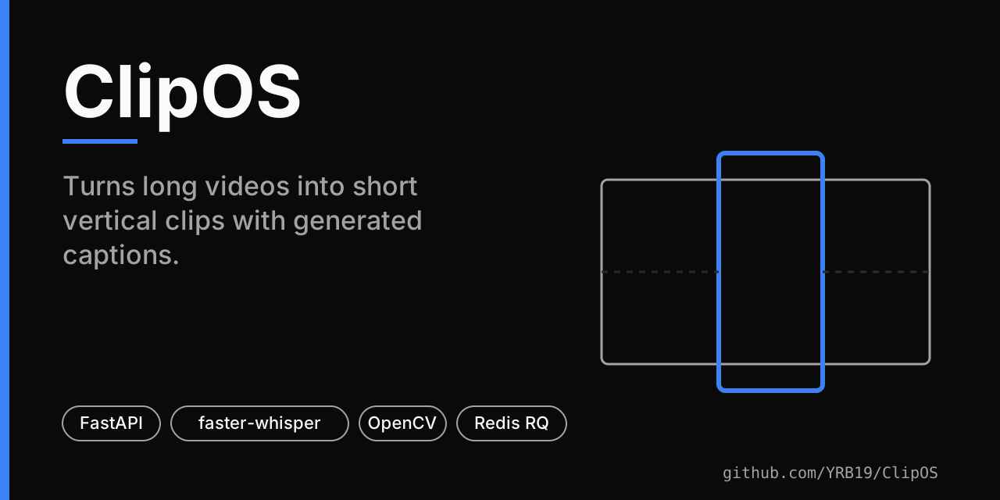
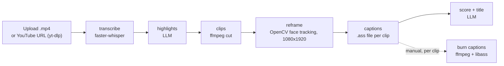

# ClipOS

Turns a long video (an uploaded `.mp4` or a YouTube URL) into short vertical clips: local transcription, LLM-picked highlights, clip cutting, face-following 1080×1920 reframing, generated caption files, and a scoring/titling pass.



> **Status:** MVP, run locally. The repository contains no screenshots, demo video or sample output, so none are shown here. No CI, no releases.

## Pipeline



All stages are implemented in `clipos-backend/app/core/`. `run_pipeline` (`core/pipeline.py`) runs transcribe, highlights, cutting, then reframe and captions for each clip, then scoring; the first failing stage marks the job `failed` and stops. **Burning captions into the video is not part of the automatic run**; it is a separate endpoint you call per clip.

## Components

| Part | What it is |
|---|---|
| `clipos-backend/` | FastAPI app, SQLModel on SQLite, Redis RQ queue, `worker.py` entrypoint, `clipos.sh` dev CLI |
| `clipos-frontend/` | React 19 + TypeScript + Vite + Tailwind 3 UI: upload, job list, progress, clip gallery, clip detail |
| `SKILL.md`, `command.md` | Author's notes for coding agents and the `clipos.sh` CLI |

Details from the code: transcription uses faster-whisper's `base` model on CPU with int8 (`core/transcribe.py`); reframing samples frames with an OpenCV Haar frontal-face detector and smooths the crop position (`core/reframe.py`), so clips without a frontal face are not tracked; highlights and scoring call NVIDIA NIM model `z-ai/glm-5.2` and fall back to OpenRouter `z-ai/glm-5.2:free` (`core/llm_fallback.py`).

## Run it locally

Prerequisites: Python 3.11+, Node 20+, Redis, ffmpeg. Caption burn-in needs an ffmpeg built with libass (the code looks for Homebrew's `ffmpeg-full` first and falls back to `ffmpeg`).

```bash
git clone https://github.com/YRB19/ClipOS.git
cd ClipOS
redis-server                                     # terminal 1
```

```bash
cd clipos-backend                                # terminal 2: API
python3 -m venv .venv && source .venv/bin/activate
pip install -r requirements.txt
cp .env.example .env                             # add NVIDIA_API_KEY and/or OPENROUTER_API_KEY
uvicorn app.main:app --reload
```

```bash
cd clipos-backend && source .venv/bin/activate   # terminal 3: worker
python worker.py                                 # on macOS prefix: OBJC_DISABLE_INITIALIZE_FORK_SAFETY=YES
```

```bash
cd clipos-frontend                               # terminal 4: UI
npm install && npm run dev                       # http://localhost:5173
```

Without an LLM key, transcription and clip cutting work, but highlight detection and scoring fail.

| Variable (`clipos-backend/.env`) | Purpose |
|---|---|
| `NVIDIA_API_KEY` | primary LLM provider |
| `OPENROUTER_API_KEY` | optional fallback provider |
| `REDIS_URL` | default `redis://localhost:6379` |
| `DATABASE_URL` | default `sqlite:///./clipos.db` |

The frontend reads `VITE_API_BASE_URL` (default in the committed `.env`: `http://localhost:8000`).

## Usage

```bash
curl -X POST http://localhost:8000/ingest/upload -F "file=@video.mp4"      # -> {"job_id": "..."}
curl -X POST http://localhost:8000/jobs/<job_id>/run                      # enqueue full pipeline
curl http://localhost:8000/jobs/<job_id>/queue_status                     # queued/started/finished/failed
```

Individual stages are also exposed: `POST /jobs/{id}/transcribe`, `/highlights`, `/clips`, `/score`, and per clip `/jobs/{id}/clips/{cid}/reframe`, `/captions`, `/burn`. `GET /jobs` and `GET /jobs/{id}` list jobs; generated files are served under `/files`. The UI offers the same flow at `/upload`, then the job's progress page and gallery.

## Testing

```bash
cd clipos-backend && pytest        # 93 test functions across 9 files
cd clipos-frontend && npm test     # vitest, 4 tests in src/__tests__/upload-flow.test.ts
npm run lint && npm run build      # oxlint, tsc -b && vite build
```

There is no CI workflow, so no pass/fail status is published here.

## Limitations

- Local, single-user tooling: no authentication on the API, and the generated files directory is served openly.
- `captions.py` contains a hard-coded Homebrew path for `ffmpeg-full` (macOS/Apple Silicon); other platforms fall back to `ffmpeg` on `PATH`.
- Clip quality depends on the configured LLM and on frontal faces being visible; no quality metrics have been measured.
- `clipos-backend/payload.json` and the `clipos-frontend/@/` directory look like development leftovers.
- The README previously called ClipOS a clone of another commercial product; ClipOS is independent and makes no feature-parity claim.

## Licence

The repository has no LICENSE file, so no licence is declared.
