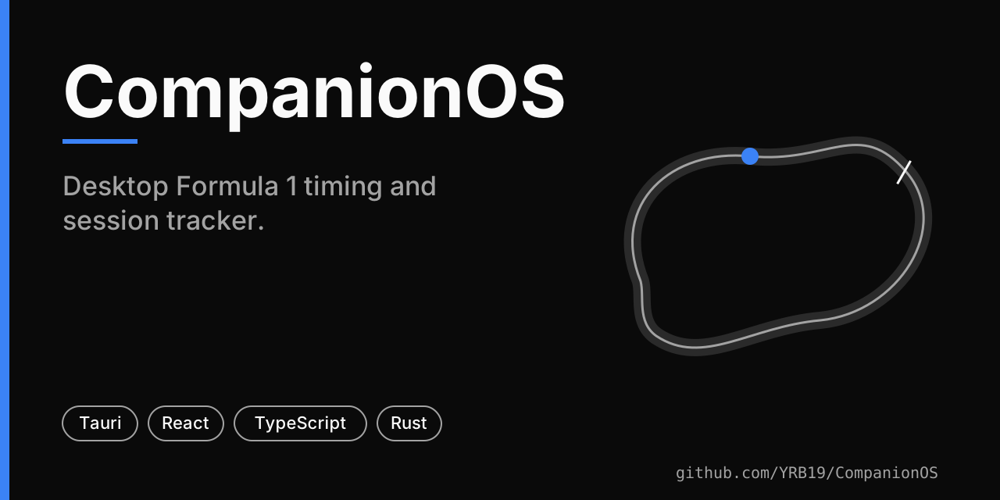
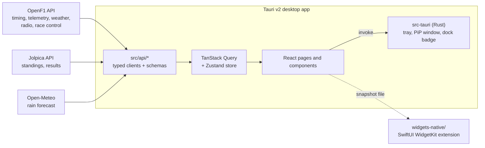

# CompanionOS

A desktop Formula 1 timing and session tracker built with Tauri v2, React and strict TypeScript. It streams live and historical data from free, keyless public APIs into a native window with a tray menu, a floating picture-in-picture widget and a macOS dock badge.



> **Status:** active development, no releases, app version `0.0.0`. No screenshots are committed, so none are shown. Known issues are in [`BUGS.md`](BUGS.md). The dock badge and WidgetKit code are macOS-specific.

## What it does

Pages (routes in `src/router.tsx`): **Dashboard** (live standings, gaps, sectors, tyres), **Track** (circuit outline and driver positions), **Telemetry**, **Radio** (team radio clips), **Weather**, **Driver**, **Constructor**, **Weekend** (schedule), **History**, **Settings**, plus a command palette (`Cmd+K`).

Native integration (`src-tauri/src/main.rs`): tray menu with the current top positions, a floating always-on-top picture-in-picture window, macOS dock badge, desktop notifications, single-instance handling.

## Architecture



Derived from `src/api/`, `package.json`, `src-tauri/src/main.rs` and `widgets-native/README.md`. The WidgetKit extension is source only: its README says it must be added to an Xcode target by hand, so it is not part of a normal `pnpm tauri build`.

## Stack

Tauri 2 (Rust, plugins: notification, dialog, shell, global-shortcut, clipboard), React 18, TypeScript, Vite, Tailwind CSS 4, TanStack Query, Zustand, uPlot, cmdk, React Router 7. Tooling: pnpm, ESLint (zero warnings), Prettier, Husky, Vitest, MSW, Playwright, WebdriverIO.

## Data sources

[OpenF1](https://openf1.org/), [Jolpica](https://jolpica.dev/) (Ergast-compatible) and Open-Meteo. No API keys; base URLs can be overridden as shown in `.env.example`.

## Install and run

Prerequisites: Node.js, pnpm, the Rust toolchain and the [Tauri platform prerequisites](https://v2.tauri.app/start/prerequisites/).

```bash
git clone https://github.com/YRB19/CompanionOS.git
cd CompanionOS
pnpm install
pnpm tauri:dev        # development, hot reload
pnpm tauri:build      # production bundle
```

## Testing and CI

```bash
pnpm verify           # lint + typecheck + unit tests + cargo check/clippy/fmt
pnpm test:rust        # cargo test
pnpm test:e2e         # Playwright (browser-only, Vite dev server)
pnpm test:live        # live OpenF1/Jolpica schema-drift checks
pnpm test:soak        # long-running stability test
```

Workflows in `.github/workflows/`:

| Workflow | Trigger | What it runs |
|---|---|---|
| `ci.yml` | push to main, pull requests | macOS: ESLint, typecheck, Vitest, cargo check/clippy/fmt, `cargo test` |
| `e2e.yml` | push to main, manual | macOS: Tauri debug build and Playwright; both steps use `continue-on-error`, so a failure there does not fail the run |
| `schema-drift.yml` | weekly (Mon), manual | live API schema tests; opens an issue on failure |
| `soak.yml` | weekly (Sun), manual | soak tests on macOS |

**CI status:** the last status ProfileOS recorded for the `CI` workflow (2026-10-21, from a run dated 2026-07-29) was **failing**. The failure logs were not readable from the environment used for this audit, so the cause is not documented here, and no passing badge is shown. Check the [Actions tab](https://github.com/YRB19/CompanionOS/actions) for the current state.

## Limitations

- Depends on the availability and schema stability of third-party public APIs; the schema-drift workflow exists for that reason.
- Dock badge and WidgetKit are macOS-only; behaviour on other platforms is not documented.
- Between race weekends the app replays the most recent completed session from cached data.
- No licence file (the previous README said "Add license information here").
