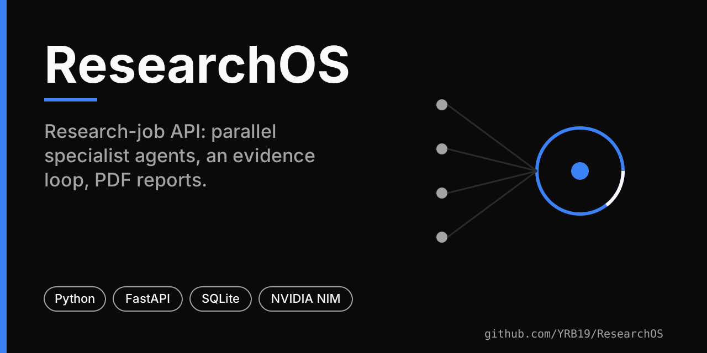
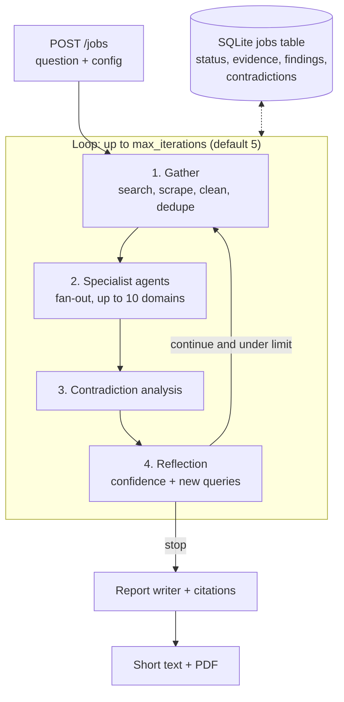

# ResearchOS

A research-job API. You post a question; a background loop gathers web evidence, runs up to ten specialist LLM agents over it, looks for contradictions, decides whether to search again, and produces a short text summary and a PDF report with numbered citations.



> **Status:** Python service under development, migrated from n8n workflows to Python in August 2026. The test suite uses mocked HTTP and no live-provider run is documented in the repository. There is no Telegram client: see [Limitations](#limitations).

## How a job runs



Derived from `app/orchestrator.py`. After every step the job row is updated, so a crash leaves partial state in SQLite.

## Evidence handling

- **Search** (`app/search.py`): provider order Tavily, then Serper, then DuckDuckGo, with retries and per-provider timeouts.
- **Scrape** (`app/scrape.py`): Jina, then Firecrawl, then a plain HTML fetch.
- **Process** (`app/process.py`): cleans and chunks page text, deduplicates by normalised URL and content fingerprint, and adds domain metadata.
- **Agents** (`app/agents.py`): `technical`, `academic`, `financial`, `legal`, `news`, `market`, `product`, `scientific`, `security`, `historical`. Each agent receives an evidence summary with truncated excerpts and returns a verdict, findings, a confidence value and recommended follow-up queries (capped at 20 unique).
- **Contradictions** (`app/contradictions.py`) and **reflection** (`app/reflection.py`) call the LLM to flag conflicts and decide whether to continue; the loop stops at `max_iterations` regardless.
- **Report** (`app/report.py`, `citations.py`, `export.py`): Markdown report with numbered citations, rendered to PDF with fpdf2; `delivery.py` builds the short text (at most 3500 characters).

## Stack

Python 3.12, FastAPI, uvicorn (one worker), aiosqlite/SQLite, httpx, fpdf2, python-dotenv. LLM calls go to the NVIDIA NIM OpenAI-compatible endpoint by default (`app/llm.py`). Runtime pins are in `requirements.txt`.

## Run it

```bash
git clone https://github.com/YRB19/ResearchOS.git
cd ResearchOS
docker build -t researchos .
docker run -d --name researchos -p 8000:8000 -v researchos-data:/data researchos
curl http://localhost:8000/health        # {"status":"ok"}
```

`DB_PATH` (default `/data/jobs.db`) is the only environment variable the code reads. `deploy/compose-service-snippet.yml` is a fragment for an existing Compose file on the author's server; its `<PROJECT_ROOT>`, `<DATA_VOLUME>` and `<DOCKER_NETWORK>` markers must be replaced before use, and it references a `.env` file that the application does not otherwise consume.

## Configuration: per request

Provider keys, models and loop settings are not read from the environment. They are passed in the `config` object of each `POST /jobs` request. The keys the code looks up are:

```json
{
  "research_question": "…",
  "config": {
    "research": { "max_iterations": 3, "confidence_threshold": 0.75,
                  "agents_enabled": ["technical", "academic"], "max_sources_total": 30 },
    "search":   { "providers": ["tavily", "serper", "duckduckgo"],
                  "tavily": { "api_key": "…" }, "serper": { "api_key": "…" } },
    "scraping": { "jina": { "api_key": "…" }, "firecrawl": { "base_url": "…", "api_key": "…" } },
    "llm":      { "active_provider": "nim",
                  "providers": { "nim": { "api_key": "…", "model": "…", "max_tokens": 1024,
                                          "base_url": "https://integrate.api.nvidia.com/v1" } } }
  },
  "initial_queries": [ { "query": "…", "purpose": "primary" } ]
}
```

`initial_queries` is optional; without it the question itself is the first query. Defaults in code: `max_iterations` 5, `confidence_threshold` 0.75.

## API

| Method | Path | Returns |
|---|---|---|
| `GET` | `/health` | `{"status":"ok"}` |
| `POST` | `/jobs` | `{"job_id", "status":"started"}`; the loop runs as a background task |
| `GET` | `/jobs` | list of jobs (id, question, status, iteration, confidence, updated_at) |
| `GET` | `/jobs/{id}` | job row with decoded `evidence`, `agent_findings`, `contradictions` |
| `GET` | `/jobs/{id}/report` | `{short_text, pdf_available, status}` |
| `GET` | `/jobs/{id}/pdf` | the PDF, once the job has completed |

Job statuses seen in the orchestrator: `gathering`, `analyzing_agents`, `analyzing_contradictions`, `reflecting`, `completed`, `failed`. The API has no authentication.

## Testing

```bash
pip install -r requirements-dev.txt
pytest tests/ -v
```

40 test functions across `tests/test_fallback.py` (search/scrape fallbacks), `test_agents.py` (fan-out, JSON repair), `test_phase4.py` (orchestrator loop) and `test_phase5.py` (report, citations, PDF). They use mocked HTTP and need no keys. This repository has no CI workflow, so no pass/fail status is published here.

## Limitations

- **No Telegram.** An earlier README described Telegram delivery. `app/` contains no Telegram client or polling code; `delivery.py` only budgets message length. Telegram is not a supported interface.
- **No authentication** on any endpoint; run it on a private network.
- Output quality depends on the LLM and search providers you configure; no benchmark or evaluation against other tools has been done.
- Knowledge graph, memory and source-trust workflows existed in the n8n version and are not ported (`reference/`).

## Provenance and licence

`reference/` archives the original n8n workflows; `RESEARCHOS_PYTHON_MIGRATION_PLAN.md` and `N8N_WORKFLOW_CHANGES.md` document the migration. The repository currently has **no LICENSE file**, so no licence is declared.
