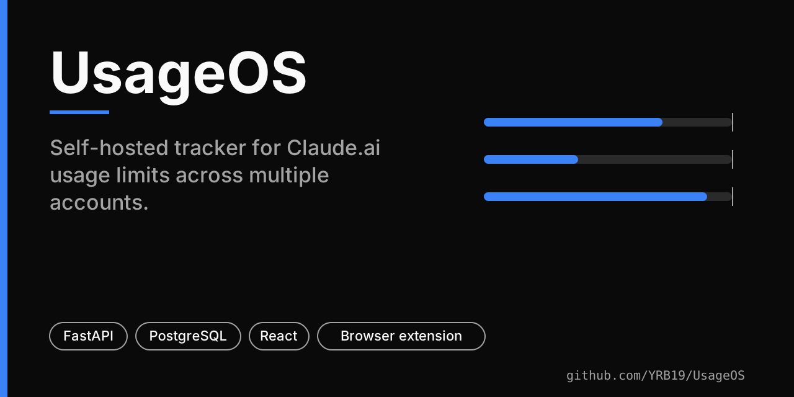
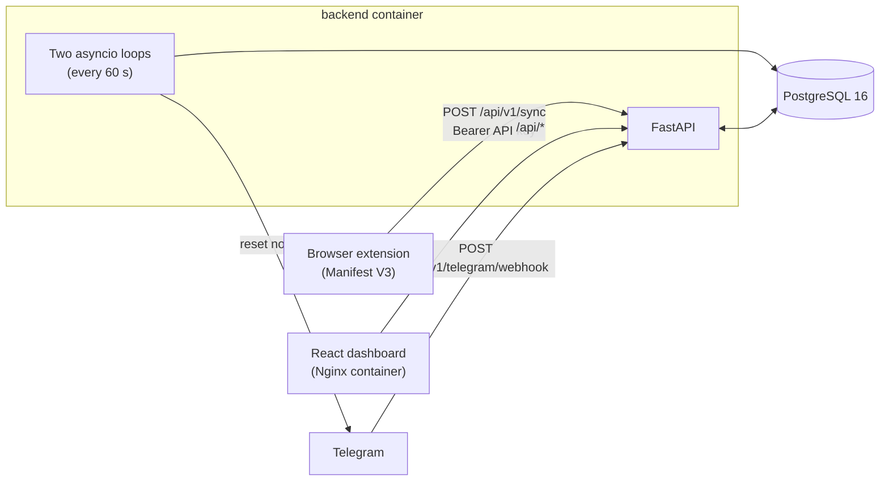

# UsageOS

Self-hosted tracker for Claude.ai usage limits across multiple accounts: a browser extension reads the limits, a FastAPI backend stores them, a React dashboard shows them, and an optional Telegram bot announces limit resets.



> **Status:** personal project. There is no automated test suite, no CI and no release yet. See [Limitations and security](#limitations-and-security) before exposing it to the internet.

## What it does

- **Dashboard** (`frontend/`): one card per Claude account with nickname, colour, avatar, usage bars for each limit, an editable note, and a history chart (routes `/` and `/account/:id`).
- **Browser extension** (`extension/`): reads usage and limit data while you use claude.ai and syncs it to your backend with a bearer API key.
- **Telegram bot** (optional): a webhook that answers `usage` and `note` commands, plus messages roughly 10 minutes and 1 minute before a limit resets for accounts that have a chat id.
- **Maintenance note**: a shared banner note, readable without a key and writable with one.

## Architecture



Derived from `docker-compose.yml`, `backend/app/main.py` and `backend/app/routers/`. The notification loops run inside the backend process, not in the extension.

## Stack

| Part | Technology (from the manifests) |
|---|---|
| Backend | FastAPI 0.115, SQLAlchemy 2, Alembic, psycopg2/asyncpg, httpx, Python 3.12 image |
| Database | PostgreSQL 16 (Alpine image) |
| Dashboard | React 18, Vite, TypeScript, Tailwind CSS 3, Framer Motion, Recharts, Chart.js, Axios |
| Extension | Manifest V3 JavaScript (Chrome, Firefox and Electron manifests are included) |
| Packaging | Docker Compose (Nginx serves the built dashboard and proxies `/api/`) |

## How it works

1. The extension collects per-account limit data (`usage_pct`, `resets_at`) and posts it to `/api/v1/sync`. Accounts are created from the first sync.
2. The backend stores each sync as an event and serves the latest event per account to the dashboard.
3. Every 60 seconds the backend looks at the newest event per account that has a `telegram_chat_id`. A limit resetting within the next 10 minutes, and again within the next 1 minute, triggers one message each. A `notification_log` unique constraint prevents repeats for the same reset.
4. Tables are created at startup with SQLAlchemy `create_all`. The Alembic migrations are in `backend/alembic/versions/`, but the Dockerfile does not run them.

## Install

Prerequisites: Docker with Compose v2, and a Chromium-based or Firefox browser.

```bash
git clone https://github.com/YRB19/UsageOS.git
cd UsageOS
cp .env.example .env            # set POSTGRES_PASSWORD, DATABASE_URL, ATLAS_API_KEY
openssl rand -hex 32            # use the output as ATLAS_API_KEY
docker network create atlas-network   # docker-compose.yml declares this network as external
docker compose up -d --build
```

| Service | Address |
|---|---|
| Dashboard | `http://localhost:3000` |
| API (and `/docs`) | `http://localhost:8000` |
| Health | `GET /api/v1/health` |

PostgreSQL is published on `127.0.0.1:5432` only. For HTTPS, put your own reverse proxy in front of ports 3000 and 8000. `DEPLOY.md` describes one author's server layout and Cloudflare Tunnel setup; some of its directory names (`atlas-claude-backend/`) predate this repository's layout.

### Extension

1. Open `chrome://extensions`, enable Developer mode, choose **Load unpacked** and select the `extension/` folder.
2. Open the extension's options page and enter your server URL (for example `https://<your-domain>`) and the same API key as `ATLAS_API_KEY`.
3. Open claude.ai; the extension starts syncing.

`extension/manifest.json` still lists the placeholder host permission `https://your-server-url.com/*`, and its `author` and Firefox id are placeholders too. Whether syncing works for your own domain without editing the manifest has not been verified.

## Configuration

| Variable | Used by | Notes |
|---|---|---|
| `POSTGRES_USER`, `POSTGRES_PASSWORD`, `POSTGRES_DB` | Compose / Postgres | `POSTGRES_USER` and `POSTGRES_DB` are fixed to `atlas` in `docker-compose.yml`; only the password is read |
| `DATABASE_URL` | backend | must match the Postgres credentials |
| `ATLAS_API_KEY` | backend, extension | bearer token required by `/sync` and the maintenance-note `PUT` |
| `TELEGRAM_BOT_TOKEN` | backend | optional; enables the bot and notifications |
| `VITE_API_URL`, `VITE_API_KEY` | dashboard build | build-time arguments; see the security notes |
| `CORS_ORIGINS` | backend | read by the settings class (JSON list, default `["*"]`) but not passed through by `docker-compose.yml` |

## Usage

Telegram setup (optional): create a bot with BotFather, then register the webhook with your public URL.

```bash
curl -X POST "https://api.telegram.org/bot<TOKEN>/setWebhook" \
  -d url="https://<your-domain>/api/v1/telegram/webhook"
```

Bot commands: `usage` (all accounts), `usage <nickname>`, `note <nickname> <text>`, `help`. Set an account's `telegram_chat_id` from the dashboard to receive reset notices.

API (all under `/api/v1`):

| Method | Path | Auth |
|---|---|---|
| `POST` | `/sync` | bearer key |
| `GET` | `/sync/{org_id}` | bearer key |
| `GET` | `/health` | none |
| `GET`, `PATCH` | `/accounts`, `/accounts/{id}` | none |
| `GET` | `/accounts/{id}/sync-history` | none |
| `GET`, `PUT` | `/accounts/{id}/note` | none |
| `GET`, `POST` | `/accounts/{id}/avatar` | none |
| `GET` | `/maintenance/note` | none |
| `PUT` | `/maintenance/note` | bearer key |
| `POST` | `/telegram/webhook` | none |

## Testing and CI

There are no tests and no workflows in this repository today. Nothing in this README should be read as tested behaviour.

## Limitations and security

- Account, note, avatar and Telegram-webhook endpoints do not check the API key (table above). Anyone who can reach the backend can read usage data and edit nicknames, notes and chat ids. Keep it on a private network, behind a VPN or tunnel with access control, or add authentication before publishing it.
- The webhook does not verify a Telegram secret token, and any chat can run `note <nickname> <text>`.
- If you pass `VITE_API_KEY` at build time it is compiled into the dashboard's JavaScript and is visible to anyone who can load the dashboard.
- CORS defaults to `*`.
- The backend runs `--workers 2`, so each worker starts its own notification loops; the database constraint prevents duplicate messages for the same reset.
- The extension reads claude.ai responses, which are not a public API and can change without notice.

## Licensing and attribution

The browser extension in `extension/` is derived from [lugia19/Claude-Usage-Extension](https://github.com/lugia19/Claude-Usage-Extension), which is published under GPL-3.0. It keeps that project's GPL-3.0 licence text (`extension/LICENSE`), and some of its links (for example the donation links in the popup) and the text of `extension/README.md` and `extension/PRIVACY.md` still refer to the original author. All credit for the original extension belongs to its author.

The backend (`backend/`) and dashboard (`frontend/`) are written for this project. **A repository-level licence has not been chosen yet**, so there is no `LICENSE` file at the root and the terms for the backend and dashboard are not declared. Existing licence and copyright notices have been left untouched.
